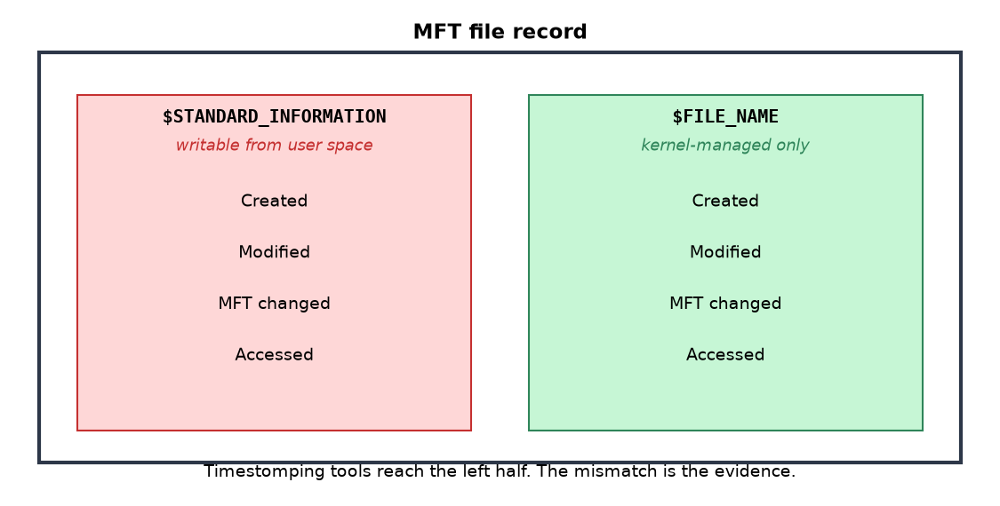
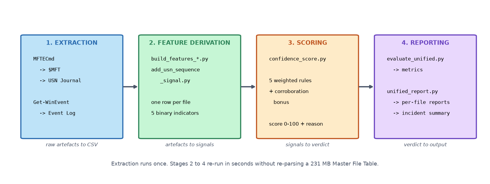
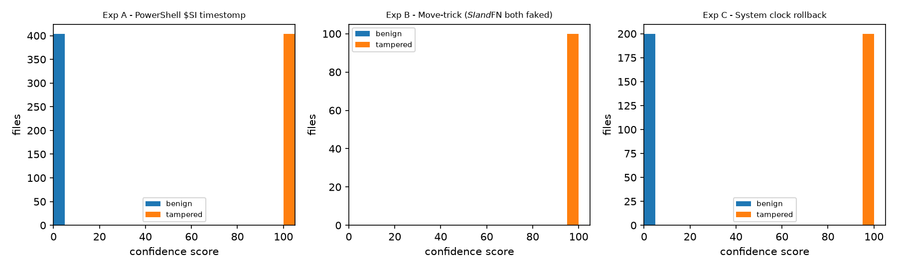
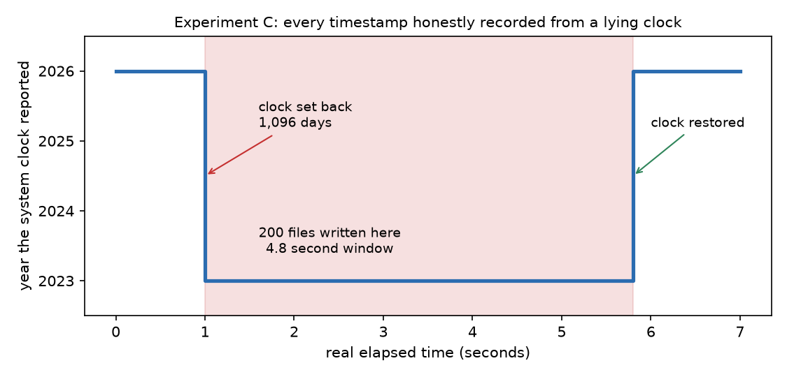
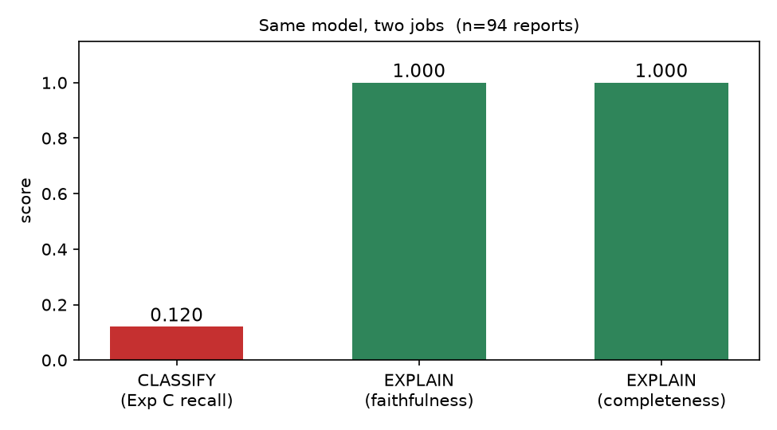

# Detecting NTFS Timestamp Tampering

A Python tool that catches faked file timestamps on NTFS by cross-checking three independent Windows artefacts instead of trusting one. On a 1,308-file test set it caught all 704 tampered files with no false positives, where the conventional single-artefact check missed 43% of them.

MSc Cyber Security dissertation, University of Birmingham Dubai, 2026.

## Why bother

If you break into a machine and drop something on disk, the first thing that gives you away is a file with yesterday's date sitting in a folder full of 2019 files. So attackers backdate it. MITRE tracks this as [T1070.006](https://attack.mitre.org/techniques/T1070/006/), and the tooling to do it is trivial.

The standard defence is to compare two timestamp fields inside the MFT record: `$STANDARD_INFORMATION`, which any program can write to, against `$FILE_NAME`, which only the kernel controls. When they disagree, something touched the file.

That works against a basic attack and fails against anything smarter:

- **Set the fake date, then move the file.** Windows copies `$SI` into `$FN` during the move, so the attacker gets the kernel to forge the protected field for them. Both fields now agree.
- **Roll the system clock back, then write the file.** Nothing gets falsified at all. Every timestamp is recorded honestly, by a clock that's lying, so every field agrees.

Across the three attacks I tested, the single-artefact check missed 300 of 704 tampered files (43%). It caught the basic attack completely and the other two not at all.



## What it does instead

Three sources, cross-referenced:

| Artefact | What it tells you |
|---|---|
| `$MFT` | `$SI` vs `$FN` timestamp disagreement |
| USN Journal | Metadata changes after a file was closed, and sequence numbers that record the order writes happened in |
| Windows Event Log | System clock changes (Kernel-General, Event ID 1) |

The USN sequence number is the one I'd point at. Sequence numbers increment in write order and have no relationship to what the clock said at the time. You can't rewind them. So a file claiming to be three years older than the journal entries written before it is making an impossible claim.

Every other check in the set gets beaten by at least one attack. The sequence signal is the only one that held up against all three.



Every flagged file gets a 0–100 score and a written explanation of which artefacts disagreed. Not a number you have to take on faith. Sample output is in `results/forensic_report.md`, and the per-experiment breakdowns are in `results/reason_reports_A.md` through `_C.md`.

## Results

Tested on 1,308 files from the [NapierOne](https://github.com/simonrdavies/NapierOne) corpus, with three attacks generated in an isolated Windows 10 VM:

1. PowerShell timestomping (`datagen/timestomp.ps1`)
2. Directory relocation, which tricks Windows into falsifying `$FN` (`datagen/movetrick.ps1`)
3. System clock rollback of three years, inside a 4.8-second window (`datagen/clocktamper.ps1`)

| | |
|---|---|
| Tampered files detected | 704 / 704 |
| Clean files cleared | 604 / 604 |
| False positives | 0 |
| Single-artefact baseline miss rate | 43% (300 / 704) |



Clean files score zero, tampered files score 95 or 100, and nothing sits in between.

The clock rollback experiment is the interesting one. Every timestamp-based check is blind to it, because the timestamps are internally consistent. Detection rests entirely on the Event Log and the USN sequence signal.



Full numbers are in `results/unified_evaluation.md`.

## The LLM part

I also tested whether a model could do the triage instead. Short version: not on its own.

On a balanced 150-file sample, Gemini 3.5 Flash-Lite caught 71% of tampered files overall. It matched the rules on the first two attacks and dropped to **12% recall on the clock rollback**.

Reading its reasoning showed why. It understood what a clock change meant. What it couldn't do was the date arithmetic: work out whether a particular file's timestamp fell inside a 4.8-second window against a three-year jump. A larger reasoning model failed the opposite way, flagging every file on the disk, clean ones included.

So I added one line to the evidence, stating whether each file fell inside or outside the rollback window, and changed nothing else. Same model, same prompt. Recall went from 12% to 100% with zero false positives.

That settled the architecture: **rules decide, model explains.** The deterministic engine makes the call, and the model turns it into something an analyst can read. Across 94 generated reports it invented no figures and missed no indicator.



The comparison across arms is in `results/arm_comparison.md` and `results/expC_all_arms.csv`. The raw request/response bundles are in `data/llm/` if you want to check my working.

## Repo layout

```
datagen/        PowerShell scripts that generate each attack scenario
src/features/   artefact parsing and feature extraction
src/model/      scoring, evaluation, figures
src/llm/        LLM triage harness and prompt definitions
results/        every figure and report in this README
docs/           design decisions log
```

## Running it

The raw artefact extractions aren't in this repo (they're several hundred MB), so a fresh clone can't score anything until you generate them. If you'd rather just read the output, everything in `results/` is committed, including the generated forensic reports.

**1. Install dependencies**

```powershell
pip install -r requirements.txt
```

**2. Generate the attacks.** Needs admin PowerShell on a machine you don't care about. `clocktamper.ps1` stops `w32time` and moves the system clock, so run it in a VM and nowhere else.

**3. Extract the artefacts** with [MFTECmd](https://ericzimmerman.github.io/) (`$MFT` and the USN Journal) and `Get-WinEvent` (Event Log), saving the CSVs to `data/raw/`.

**4. Run the detection pipeline**

```powershell
python src\features\add_usn_sequence_signal.py
python src\model\confidence_score.py --exp A
python src\model\confidence_score.py --exp B
python src\model\confidence_score.py --exp C
python src\model\evaluate_unified.py
```

**5. Optional: the LLM experiments.** Put `GEMINI_API_KEY=...` in a `.env` file at the repo root, then run the scripts in `src/llm/`. These make paid API calls.

Paths across the repo assume `C:\ntfs-tamper-detect`. Change them if yours differs.

## Caveats

- **The zero false positives come from a lab.** Real volumes have years of accumulated weirdness, from installer artefacts to sync clients and backup software, and I'd expect that number to move. The files are real, but the environment isn't.
- **The USN sequence signal can't tell tampering from a genuinely old file copied onto the disk.** Both look the same: an old date at a recent journal position. It needs the other artefacts to confirm.
- **The move-trick experiment has no clean control files**, so there's no false positive rate for that attack on its own.
- **The LLM results are one model family at one point in time.** Treat them as a snapshot, not a permanent verdict.
- **The dataset isn't included here.** Download NapierOne from the source linked above.

## Reading that shaped this

- Alji, M. and Chougdali, K. (2019). *Detection of Timestamps Tampering in NTFS using Machine Learning.* Procedia Computer Science, 160.
- Korol, A. (2025). *Breaking Time: Methods and Artifacts for the Forensic Detection of Timestomping on FAT32, Ext3 and Ext4 File Systems.* SANS Institute.
- Davies, S.R., Macfarlane, R. and Buchanan, W.J. (2022). *NapierOne: A modern mixed file data set alternative to Govdocs1.* Forensic Science International: Digital Investigation, 40.

## Contact

Parth Chandhok — [LinkedIn](https://www.linkedin.com/in/parth-chandhok)

